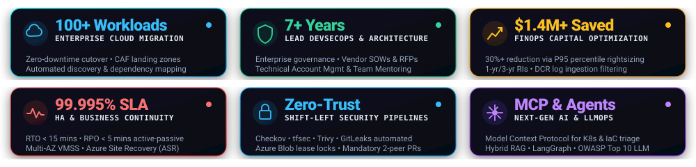
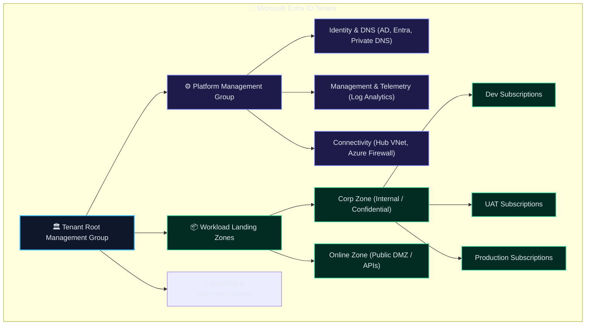
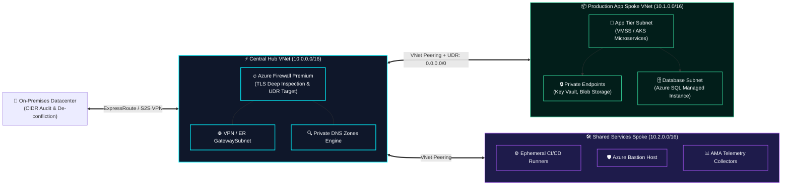
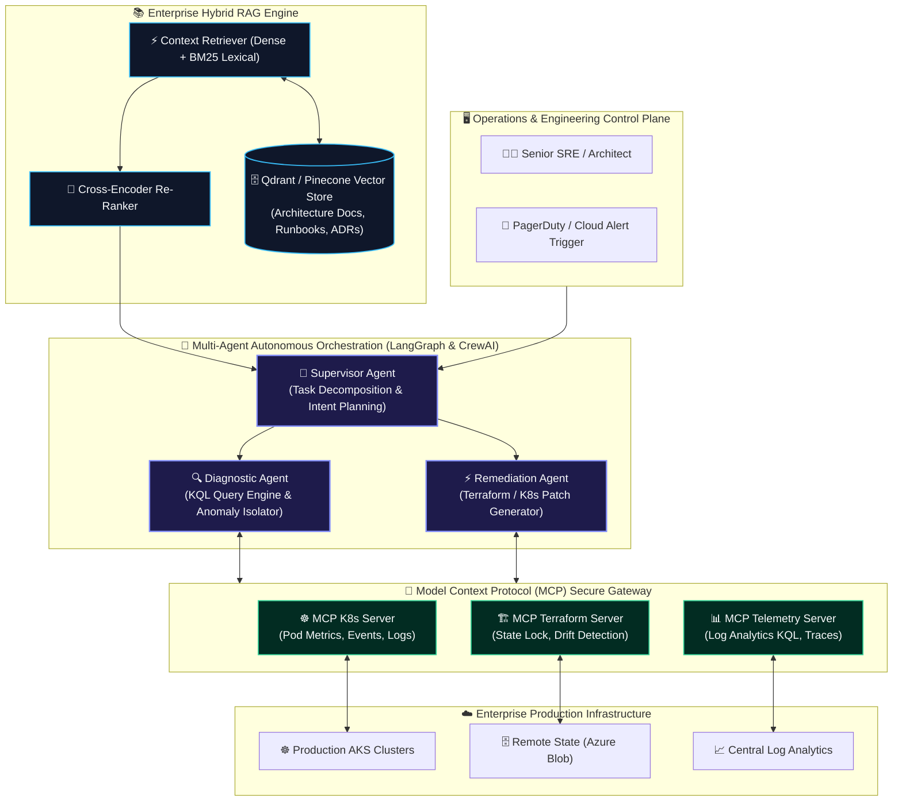

<div align="center">

<!-- Ultra-Premium Hero Banner -->


<br/><br/>

<!-- Executive Quick Connect & Status Bar -->
<a href="https://linkedin.com/in/parshuramjamdhade">
  
</a>
&nbsp;
<a href="mailto:parshuramjamdhade@gmail.com">
  
</a>
&nbsp;
<a href="https://github.com/parshuramjamdhade">
  
</a>
&nbsp;


<br/><br/>

<!-- Bento Grid Executive Metrics -->


</div>

---

## 🏛️ Executive Summary & Strategic Leadership

I am a **Lead DevSecOps Architect and Enterprise Cloud & Next-Gen AI Systems Engineer** with **7+ years of deep enterprise expertise**. I design, automate, and govern mission-critical, hyper-scale cloud environments for Fortune enterprises and high-growth organizations.

My architectural footprint bridges **Tier-1 Cloud Modernization** (orchestrating zero-downtime migrations of **100+ complex enterprise workloads** to Microsoft Azure & AWS), **End-to-End Shift-Left DevSecOps** (CIS Benchmark compliance, automated SAST/DAST, and immutable IaC delivery), **FinOps Capital Stewardship** (delivering over **$1.4M+ in audited cloud cost optimization**), and **Autonomous AI & LLMOps Infrastructure** (architecting custom **Model Context Protocol [MCP]** servers, hybrid-search RAG pipelines, and self-healing multi-agent SRE workflows).

```
                                  [ THE ARCHITECTURAL COMPASS ]
                                                |
                 "How does this technical topology drive business valuation & uptime?"
                                                |
            +-----------------------------------+-----------------------------------+
            |                                                                       |
 [ Enterprise Cloud Architecture & DevSecOps ]                     [ Autonomous AI & LLMOps Engineering ]
 • 100+ Workloads Migrated with Zero Downtime                      • Model Context Protocol (MCP) Server Infrastructure
 • Enterprise CAF Landing Zones & Management Groups                • Enterprise Hybrid RAG (Dense Vectors + BM25 Sparse)
 • Zero-Trust Hub-and-Spoke with Azure Firewall Premium            • Autonomous SRE Agents (LangGraph Incident Triage)
 • Automated Shift-Left: Checkov, GitLeaks, Trivy, Infracost       • OWASP Top 10 for LLMs Security & Context Sandboxing
 • Multi-AZ VMSS, ASR Paired Regions (RTO < 15m, RPO < 5m)         • Self-Healing GitOps Pipelines & Drift Reconciliation
```

---

## 💎 The 10 Scalability & Quality Pillars

Every mission-critical architecture I deliver is strictly measured against 10 immutable enterprise pillars:

| Pillar | Architectural Standard | Production Implementation & Technology |
| :--- | :--- | :--- |
| **01. Scalable** | Elastic compute scaling handling 10x traffic surges without latency degradation. | AKS HPA / KEDA, Azure VMSS across 3 Availability Zones, dynamic ingress routing. |
| **02. Robust** | Fault-isolated failure boundaries preventing cascade system collapse. | Circuit breaker patterns, Envoy/Istio service mesh retry policies, dead-letter queues. |
| **03. Secure** | Zero-Trust defense-in-depth across identity, network, compute, and data layers. | Microsoft Entra ID PIM (Just-In-Time access), Customer Managed Keys (CMK), NSG/ASG micro-segmentation. |
| **04. Reliable** | 99.995% availability SLA with continuous resilience verification. | Chaos engineering injection, synthetic transaction probes, SLA/SLO error budget alerts. |
| **05. Portable** | Cloud-neutral infrastructure abstractions eliminating vendor lock-in risks. | OpenTofu / Terraform modular IaC, OCI-standard container images, agnostic Helm charts. |
| **06. Governed** | Continuous policy enforcement and automated drift remediation. | Azure Policy initiatives (CIS/MCSB benchmarks), strict remote state lease locking. |
| **07. High Availability** | Zero single points of failure across regional outages. | Active-Passive paired regions, Azure Site Recovery (ASR), multi-region Azure Front Door. |
| **08. Cost-Optimized** | Continuous capital governance converting cloud spend into predictable ROI. | 30-day P95 rightsizing, 1-yr/3-yr Reserved Instances, DCR log ingestion filtering. |
| **09. Backed Up** | Immutable, ransomware-protected backups with verified recovery drills. | GRS/ZRS immutable vaults, strictly tested RTO (< 15 mins) and RPO (< 5 mins). |
| **10. Compliant & Monitored**| Full observability telemetry with real-time auditability. | Azure Monitor AMA agents, Log Analytics (KQL), Microsoft Defender for Cloud SIEM. |

---

## 🏆 Signature Architecture Showcase: 100+ Enterprise Workloads Cloud Migration

> **Mission Objective:** Migrate 100+ legacy, monolithic, and tier-1 enterprise workloads from on-premises datacenters to Microsoft Azure with **zero transactional downtime**, total CIDR de-confliction, and Day-1 CIS/SOC2 compliance.

### 1. Enterprise Tenant & Management Group Hierarchy (Microsoft CAF)



### 2. Zero-Trust Enterprise Hub-and-Spoke Networking Topology



### 3. The 5-Phase Migration Execution Lifecycle

```
[ PHASE 1: DISCOVERY ]  ===>  [ PHASE 2: ASSESSMENT ]  ===>  [ PHASE 3: LANDING ZONE ] ===> [ PHASE 4: CUTOVER ] ===> [ PHASE 5: HYPERCARE ]
• Azure Migrate agents        • TCO & ROI financial modeling • Modular Terraform CAF         • DB sync verification    • 24x7 War Room support
• App dependency graphs       • Modernization wave plan      • Zero-Trust Hub-Spoke net      • DNS TTL drop to 60s     • P95 latency baseline
• CIDR overlap resolution     • 6 R's migration strategy     • Entra PIM & Azure Policies    • Traffic reroute via AFD • Post-mortem sign-off
```

* **Cutover Window Mastery:** Orchestrated seamless weekend cutovers by locking asynchronous-to-synchronous DB replication, reducing DNS TTLs to 60 seconds, routing traffic through Azure Front Door, and validating with automated smoke tests within a 2-hour window.
* **High Availability & Disaster Recovery:** Engineered active-passive disaster recovery via Azure Site Recovery (ASR) to secondary paired regions, maintaining **RTO < 15 minutes** and **RPO < 5 minutes**.

---

## 🧠 Next-Gen AI, LLMOps & Autonomous Agent Systems

Pioneering the modern convergence of **Deep Infrastructure Engineering** and **Artificial Intelligence** to deliver autonomous, self-healing cloud ecosystems.



### Core GenAI & LLMOps Architectures Built
* **Model Context Protocol (MCP) Enterprise Servers:** Designed and deployed production MCP servers bridging LLM models with internal Kubernetes clusters, cloud APIs, and telemetry pipelines, enabling AI agents to safely read live state, inspect container logs, and execute sanctioned remediations.
* **Enterprise Hybrid RAG (Dense + BM25 + Re-Ranking):** Implemented contextual knowledge retrieval combining dense semantic embeddings with BM25 keyword matching and cross-encoder re-ranking against Qdrant/Pinecone vector databases to provide sub-15ms runbook and ADR lookups.
* **Autonomous Incident Triage Multi-Agent Teams:** Orchestrated LangGraph agent workflows that ingest Datadog/Azure Monitor alerts, correlate them with recent GitHub pull requests, execute non-destructive KQL log queries, and draft root-cause analyses (RCA) with proposed Terraform pull requests.
* **AI Security & OWASP Top 10 for LLMs:** Engineered security guardrails enforcing prompt injection mitigation, context sandboxing, automated PII masking, and strict API token quota enforcement.

---

## 🛡️ Production DevSecOps: Shift-Left Continuous Verification

Infrastructure is code; security is continuous. Every pull request executes an automated, defense-in-depth verification pipeline before touching production state:

```mermaid
flowchart LR
    Commit["👨‍💻 Git Commit\n(Feature Branch)"] --> Stage1

    subgraph Stage1["🛡️ Stage 1: Shift-Left Lint & Secrets"]
        direction TB
        T1["tflint & terraform fmt"]
        T2["GitLeaks & TruffleHog (Zero-Secret Policy)"]
    end

    Stage1 --> Stage2

    subgraph Stage2["🔍 Stage 2: Static Security & SAST"]
        direction TB
        S1["Checkov & tfsec (CIS & SOC2 Benchmarks)"]
        S2["Trivy Container Image Vulnerability Scan"]
    end

    Stage2 --> Stage3

    subgraph Stage3["💰 Stage 3: FinOps PR Cost Diff"]
        direction TB
        F1["Infracost Real-Time Cost Delta"]
        F2["Automated PR Comment with Monthly Budget Impact"]
    end

    Stage3 --> Stage4

    subgraph Stage4["📋 Stage 4: IaC Plan & State Locking"]
        direction TB
        P1["terraform plan -detailed-exitcode"]
        P2["Automated Drift Detection"]
        P3["Azure Blob Lease Distributed State Lock"]
    end

    Stage4 --> Gate{"🔒 Production Gate\n2-Peer Review\n+ Entra PIM JIT"}

    Gate -->|Approved| Stage5

    subgraph Stage5["🚀 Stage 5: Zero-Downtime Deployment"]
        direction TB
        D1["Canary / Blue-Green Progressive Rollout"]
        D2["Automated P95 Latency Health Checks"]
        D3["Instant Rollback on Anomaly Detection"]
    end

    classDef s1 fill:#0f172a,stroke:#38bdf8,stroke-width:1.5px,color:#f8fafc;
    classDef s2 fill:#1e1b4b,stroke:#818cf8,stroke-width:1.5px,color:#f8fafc;
    classDef s3 fill:#2d1b02,stroke:#fbbf24,stroke-width:1.5px,color:#f8fafc;
    classDef s4 fill:#022c22,stroke:#34d399,stroke-width:1.5px,color:#f8fafc;
    classDef s5 fill:#1c1917,stroke:#f87171,stroke-width:1.5px,color:#f8fafc;
    class Stage1,T1,T2 s1;
    class Stage2,S1,S2 s2;
    class Stage3,F1,F2 s3;
    class Stage4,P1,P2,P3 s4;
    class Stage5,D1,D2,D3 s5;
```



---

## 💰 FinOps: $1.4M+ Audited Cloud Capital Optimization

I treat cloud infrastructure like a high-performance balance sheet—eliminating waste, hedging commitments, and optimizing unit economics.

```
+----------------------------------------------------------------------------------------------------+
|                                    THE 4-PILLAR FINOPS FRAMEWORK                                   |
+----------------------------------------------------------------------------------------------------+
|                                                                                                    |
|  [ 1. Autonomous Waste Eradication ]      [ 2. P95 Percentile Rightsizing ]                        |
|  • Serverless daily scavenger jobs        • Analyze 30-day P95 CPU/Memory utilization              |
|  • Purge unattached managed disks & PIPs  • Eliminate compute over-provisioning                     |
|  • Delete obsolete VM snapshots           • Rightsize AKS node pools with KEDA autoscaling         |
|  -> Annual Savings: $180,000+             -> Annual Savings: $420,000+                             |
|                                                                                                    |
|  [ 3. Strategic Commitment Portfolios ]   [ 4. Observability Log Ingestion Tuning ]                 |
|  • 1-Year & 3-Year Reserved Instances     • Azure Monitor Data Collection Rules (DCR) at source    |
|  • Azure Savings Plans for steady-state   • Filter noisy IIS, container, and debug telemetry       |
|  • Blend on-demand with spot node pools   • Slash monthly Log Analytics bills by 38%               |
|  -> Annual Savings: $560,000+             -> Annual Savings: $240,000+                             |
|                                                                                                    |
+----------------------------------------------------------------------------------------------------+
|                       TOTAL AUDITED ENTERPRISE CAPITAL SAVED: $1,400,000+ / YEAR                   |
+----------------------------------------------------------------------------------------------------+
```

---

## 👔 Enterprise Leadership, Vendor Governance & RACI Framework

Leading technical teams requires mastery over both the CLI and commercial governance:

```
[ RFP / RFI Sourcing ]  ===>  [ Technical Evaluation Matrix ]  ===>  [ SOW & SLA Negotiation ] ===> [ RACI Sprint Delivery ] ===> [ Formal Acceptance ]
• Draft functional scopes      • Objective vendor scoring matrix    • Define deliverables & milestones • Lead multi-vendor teams     • Sign-off validation
• Solicit architecture bids    • Architecture, security, pricing    • Liability & SLA penalty clauses  • Direct KT & mentorship      • Commercial release
```

### Enterprise Delivery RACI Matrix

| Workstream / Deliverable | Lead Architect (Me) | Cloud Ops Team | InfoSec & Governance | App Dev Leads | Executive Sponsor |
| :--- | :---: | :---: | :---: | :---: | :---: |
| **Cloud Architecture & Landing Zone Blueprint** | **Accountable** | Responsible | Consulted | Consulted | Informed |
| **Zero-Trust Network & Firewall Security** | **Accountable** | Responsible | Responsible | Informed | Informed |
| **Shift-Left CI/CD Pipeline Implementation** | **Accountable** | Responsible | Consulted | Responsible | Informed |
| **100+ Workload Migration Cutover Execution** | **Accountable** | Responsible | Informed | Responsible | Informed |
| **FinOps Optimization & Budget Review** | **Accountable** | Consulted | Informed | Consulted | **Accountable** |
| **Autonomous AI / MCP SRE Tooling** | **Accountable** | Responsible | Consulted | Informed | Informed |

---

## 🛠️ The Enterprise Technology & Tooling Matrix

<div align="center">

| Domain | Technologies & Enterprise Tooling |
| :--- | :--- |
| **Cloud Platforms & Hyperscalers** |    |
| **Containerization & Orchestration** |      |
| **Infrastructure as Code (IaC)** |      |
| **DevSecOps & Shift-Left Security** |       |
| **GenAI, LLMOps & Autonomous AI** | -00D2FF?style=flat-square&logo=anthropic&logoColor=white)      |
| **CI/CD & Delivery Pipelines** |     |
| **Observability & Cloud Governance** |      |
| **Automation & Systems Scripting** |    -0078D4?style=flat-square&logo=microsoftazure&logoColor=white) |

</div>

---

## 📊 Live GitHub Analytics & Telemetry

<div align="center">

<table border="0">
  <tr>
    <td align="center" width="50%">
      
    </td>
    <td align="center" width="50%">
      
    </td>
  </tr>
  <tr>
    <td colspan="2" align="center">
      
    </td>
  </tr>
</table>

</div>

---

## 🌟 Featured Enterprise Reference Blueprints

<details open>
<summary><b>📂 Click to explore production-grade reference repositories</b></summary>

<br/>

| Repository Blueprint | Architectural Highlights | Primary Domain |
| :--- | :--- | :---: |
| **[`azure-enterprise-landingzone-tf`](https://github.com/parshuramjamdhade)** | Production-grade Terraform implementation of Microsoft CAF with Hub-and-Spoke, Azure Firewall Premium TLS inspection, and Private DNS Zones. | `Cloud Architecture` |
| **[`devsecops-shiftleft-blueprint`](https://github.com/parshuramjamdhade)** | Zero-trust CI/CD pipeline template with Checkov, Trivy, GitLeaks, Infracost, and Azure Blob lease distributed state locking. | `DevSecOps` |
| **[`mcp-k8s-autonomous-incident-agent`](https://github.com/parshuramjamdhade)** | Multi-agent autonomous system built with Model Context Protocol (MCP) and LangGraph to triage Kubernetes incidents and diagnose KQL logs. | `AI & LLMOps` |
| **[`azure-finops-cost-governor`](https://github.com/parshuramjamdhade)** | Serverless automation suite to identify orphaned disks, obsolete snapshots, unattached PIPs, and enforce DCR log filtering. | `FinOps` |

</details>

---

## 🤝 Executive Advisory & Strategic Connect

I partner with forward-thinking enterprise leaders, CTOs, and Engineering Directors on:
- **Cloud Modernization & Large-Scale Migrations (100+ Workloads)**
- **Lead / Principal DevSecOps & Enterprise Cloud Architect Roles**
- **Autonomous AI & Model Context Protocol (MCP) Infrastructure Integration**
- **FinOps Capital Governance & Cloud Cost Reclamation**

<div align="center">

<br/>

<a href="https://linkedin.com/in/parshuramjamdhade">
  
</a>
&nbsp;&nbsp;&nbsp;&nbsp;
<a href="mailto:parshuramjamdhade@gmail.com">
  
</a>
&nbsp;&nbsp;&nbsp;&nbsp;
<a href="https://github.com/parshuramjamdhade">
  
</a>

<br/><br/>

<sub>Engineered with precision for hyper-scale enterprise resilience. © Parshuram Jamdhade. All Rights Reserved.</sub>

</div>
